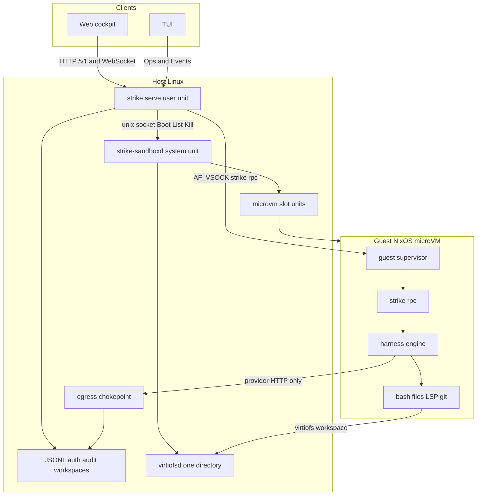
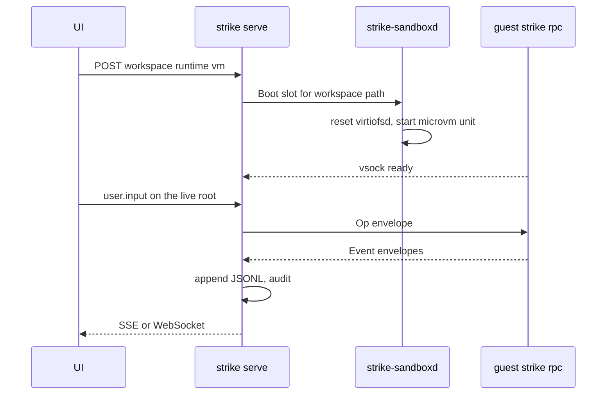

# Sandbox architecture: a NixOS dev VM as a Strike service

Status: feasibility RFC for [#1290](https://github.com/jonathanung/strike/issues/1290).
Angle: architecture (where the engine sits, the host–guest bus, protocol and
API seams, plugin versus system service). Sibling angles own the hypervisor
matrix, the threat model, self-configuration, and the web UI. This page does
not change code.

Wire schema today is `pkg/protocol` **1.18.0**. Nothing here bumps it.

## Verdict

**Go with conditions.**

Strike can run a session's engine inside a NixOS microVM without folding a
hypervisor into the harness. The host keeps `strike serve`, the session
JSONL, auth, audit, and the workspace registry. The guest runs `strike rpc`
and the tools that touch the workspace. One long-lived VM per workspace is
the grain that matches both the existing daemon and the measured boot cost
of the references. Delegated children stay in that guest and use the
worktree mode that already exists.

Effort for that slice: **L**. The full matrix (a VM per child, a credential
vault, snapshots, macOS) is **XL** and is not part of the yes.

Conditions, all of them:

1. This is a **system service** beside the daemon, not an Agent Plugin and
   not a `harness/engine` feature. The engine learns about it only through
   interfaces `cmd/strike` already injects.
2. **[#1260](https://github.com/jonathanung/strike/issues/1260) lands first.**
   A session must record a workspace id and the engine must use that
   directory. A VM that mounts the daemon's cwd mounts the wrong tree.
3. **VSOCK** carries Ops and Events. **virtiofs** carries the workspace
   directory and nothing else. SSH and 9p are not the session bus.
4. `~/.strike` (auth, daemon token, session logs, audit) is not exported
   into the guest. Provider calls leave the guest only through a host
   egress chokepoint. Until that chokepoint exists, a VM session uses a
   provider that needs no secret (echo) or a host-terminated tunnel.
5. Linux with KVM for v1. The user daemon does not open `/dev/kvm`.
6. `session.childIsolation` stays `off` | `shared` | `worktree` for the
   MVP. A later `vm` value means a **sibling** slot on the host, never a
   nested hypervisor. That is a new mode, not a second spelling of
   worktree ([webui-planned.md](../../webui-planned.md) forbids a second
   flag for the same behavior).

## Question

How would Strike run a session, or its delegated children, inside a NixOS
dev VM: where the engine and the daemon live, what crosses the host–guest
boundary, which protocol and API changes are required, and how that fits as
a plugin or a system service rather than core.

Jonathan's note to "run ham in there" is read as: the agent harness runs in
the guest, and the guest is a NixOS system the agent may reconfigure. That
reading is an inference from the issue text. The placement below is the
default if that reading is right. Option B records the alternative.

## What Strike does today

Verified against `main` at `f47dcb26`. Paths are the source of truth if this
page drifts.

### One host process owns the session

`cmd/strike` is the composition root. It builds a `harness/engine`, and the
frontend only sees `Ops()` and `Events()` plus `host.Services`
([ARCHITECTURE.md](../../ARCHITECTURE.md)). `strike serve` is that same
composition, wrapped in HTTP:

- `runServe` in `cmd/strike/serve.go` calls `assemble`, then `spawnRoot`.
  Each live root is an in-process engine. `LiveHub` multiplexes roots.
  Events are published to the web socket and SSE from the host process.
- The JSONL tee sits in the host (`runSession` appends before the UI sees
  the event). The engine does not write `~/.strike/sessions`.
- `strike daemon install` (`cmd/strike/daemon.go`) writes a **systemd user**
  unit whose command is `strike serve --auth --token-file`. Bind stays
  loopback unless `--allow-private-bind` and `--auth`
  ([gateway.md](../../gateway.md)). Gateway's current sentence — one
  process, the engine inside it — is accurate today and is the sentence
  this design changes.
- `internal/frontend/rpc` is a JSON-RPC 2.0 bridge over any `io.Reader` /
  `io.Writer`. Method traffic is the same Op envelope and Event envelope
  as the web socket. Session list, fork, and load are host methods on that
  server, not engine Ops (`docs/protocol.md`, lifecycle contract).

### Tools run on the engine's machine

`harness/tool` builtins resolve paths against `tool.Context.WorkDir` and
run bash through `RunProcess` → `sandbox.Wrap` (Linux `bwrap`, macOS
`sandbox-exec`). There is no remote tool executor. LSP and MCP stdio
servers are children of the same process. Product tools (`memory_write`,
`issue_write`, `plan_*`, `artifact_*`, `ledger_*`) take store interfaces
constructed in `cmd/strike/assemble_tools.go` and talk to files under
`~/.strike`, not to the workspace.

Kernel seams on `engine.Options` (`harness/engine/deps.go`) already keep
product stores out of the harness module: `MemorySource`, `LedgerSource`,
`PlanStore`, `AttachmentStore`, `WorktreeBinder`, artifact and ledger
projectors. Those seams are prompt and handoff projections. The tool
implementations are separate interfaces (`tools.MemoryStore` and its
siblings) injected at assemble time. Both layers can be satisfied by a
client that dials the host. That is the extension point; it is not a
network protocol yet.

### Child isolation is a filesystem mode

`session.childIsolation` and `task.isolation` are `off`, `shared`, or
`worktree` (`harness/engine/deps.go`, `docs/config.md`). `off` and `shared`
both mean the parent's tool cwd. `worktree` checks out
`<repo>/.strike/worktrees/<child-id>/` via `WorktreeBinder` and, on
completion, puts a unified diff on `CompletionHandoff.Patch` for
`patch_collab`. Outside a git repo the spawn soft-fails to shared.
`ChildStarted.Isolation` and `CompletionHandoff.Isolation` document
`shared` | `worktree` only (`pkg/protocol`).

[#1290](https://github.com/jonathanung/strike/issues/1290) says the modes
are `none` / `worktree` / `vm`. The code has no `none` and no `vm`. Empty
and unknown strings normalize to a non-worktree mode. This RFC does not
rename `shared` to `none`.

### Workspaces do not root the engine

`internal/persist/workspace` stores id, name, path, an optional rules file,
and an optional permission mode (`~/.strike/workspaces.json`). The type
comment and [webui-daemon.md](../../webui-daemon.md) say the same thing:
sessions do not store a workspace id, and activate does not change the
engine cwd. Live roots still spawn in the daemon's working directory.
[#1260](https://github.com/jonathanung/strike/issues/1260) is the open
issue that binds a session to a workspace, loads that workspace's rules,
applies its permission mode, and rejects child cwds outside the workspace
roots. [webui-planned.md](../../webui-planned.md) already says not to add
a second flag that duplicates worktree isolation.

### Plugins are packages, not runtimes

[plugins.md](../../plugins.md) is explicit: a plugin is not a new runtime,
not a Go `plugin` ABI, and not a way to inject arbitrary provider code.
In-process Go plugins, a Node host, and silent executable startup from an
untrusted bundle are out of scope for the v1 model. A bundle may contribute
skills, MCP servers, agents, workflows, themes, provider profiles,
harnesses, hooks, and panes. Executable contributions start only after a
trust record matches digest, source, and capability set. A harness
contribution is a subprocess that speaks JSONL to the function-harness
adapter. It is not a supervisor, and it cannot hold `/dev/kvm`.

### Containers are the nearest shipped analogue

`internal/integrate/container` shells out to `docker` or `podman`
([container.md](../../container.md)). `strike --launch-inside-container`
copies the host `strike` binary into the container and execs it with the
workspace mounted. `STRIKE_ISOLATION` records the posture. The ladder in
`pkg/protocol/isolation.go` is `host+yolo`, `host+default`, `host+sandbox`,
`container`, `container+no-network`. There is no `vm` rung. The TUI must
not import `internal/integrate/container`; status is supposed to arrive
through `host.Services` and protocol events. A VM backend should follow
that boundary, not a new one.

`harness` must not import `internal/*`. A VM driver that lived in
`harness/engine` would violate that, and it would force every embedder to
link a hypervisor.

## What the references actually do

### peasant-labs/infra

Read: `docs/runner-vm-spike-report.md` (2026-09-30), `docs/runner-pool.md`,
`runner-dispatcher/README.md`, `runner-dispatcher/internal/vm/driver.go`,
`internal/vm/systemdvm/driver.go`, `internal/vm/subprocess/driver.go`,
`internal/vm/dryrun/dryrun.go`, `modules/nixos/services/runner-dispatcher/default.nix`.
The slot guest Nix (the spike says 571 lines under the maintainer's
dotfiles, `modules/nixos/virtualisation/runner-vm/`) is **not in this
repository**. It was not read.

The dispatcher is a host Go process. For each GitHub job it mints a
one-shot JIT config and boots exactly one VM. The contract is small:

```go
type Driver interface {
    Boot(ctx context.Context, spec BootSpec) (Instance, error)
    List(ctx context.Context) ([]Instance, error)
    Kill(ctx context.Context, id string) error
}
```

Three backends ship: `dryrun` (in memory), `systemd` (writes a 0400 JIT
file, `try-restart`s `microvm-virtiofsd@<slot>`, then `systemctl start
microvm@<slot>`), and `subprocess` (a host boot command, process-group
SIGTERM then SIGKILL). The NixOS module runs the dispatcher as a **system**
unit with `LoadCredentialEncrypted` so the GitHub App key is not readable
by the service. The guest sees a read-only virtiofs of the JIT file and a
shared virtiofs cache. It does not see the App key or the host podman
socket. The spike's negative security probe had not been run; isolation
was argued by construction.

Measured on that host, idle slots hold no memory. A job reached the runner
about **35 s** after queue (about 10 s to guest userspace, about 15 s
loading a baked container image, then register). Boots inside one planning
cycle were serialized, roughly 21 s extra per additional VM. The README's
status checklist still says the hypervisor driver is unwired and smoke has
not run; the spike report supersedes that checklist.

This is an **ephemeral CI** shape: one VM per job, exit when the job
exits, cache shared because the jobs are the operator's own CI. Strike
sessions are interactive and long-lived, and the agent is adversarial
toward the host. The driver interface and the "credentials stay on the
host, virtiofsd is reset before boot" lessons transfer. The lifetime and
the shared-cache default do not.

### dayvidpham/nix-openclaw-vm

Read: `ARCHITECTURE.md`, `README.md`, and the VSOCK, TAP, credential, and
virtiofs sections of `modules/openclaw-vm/default.nix`,
`modules/openclaw-vm/guest.nix`, `modules/credential-proxy/default.nix`,
and `modules/credential-proxy/guest.nix`. The credential-proxy Go sources
and the TLA+ model were not re-derived here; the architecture doc is the
security angle's source. `nix flake check` was not run (no `nix` on this
machine).

Three deployment modes exist: a QEMU microVM (`openclaw-vm` +
`credential-proxy`), rootless Podman (`openclaw`), and a dev mode. The
agent process (OpenCode / OpenClaw gateway) runs **in the guest**. The
host runs the proxy, the VM unit, and the secret stores. The bus is:

| Path | Mechanism | What crosses |
|---|---|---|
| Control and proxy | `AF_VSOCK` (host CID 2, guest CID configured, ports 18789 / 18790 / 8200) | gateway reachability, HTTP(S) to the credential proxy, dev-mode OpenBao |
| Nix store, optional | virtiofs tag `nix-store`, source `/nix/store` | the host store, read-only, so rebuilds skip embedding the store in erofs |
| Secrets | QEMU `fw_cfg` (`microvm.credentialFiles`) plus a virtiofs of `/var/lib/credproxy` in dev mode | gateway config, placeholder env, MITM CA cert. The CA **key** stays on the host |
| Human debug | serial socket `console.sock`; QEMU guest agent only in dev mode | logs and break-glass exec, not the application protocol |
| Packet network | TAP + nftables | DNS to the host and Tailscale; other TCP/UDP denied when the proxy is on |

Their rationale for VSOCK, which this RFC adopts: it is not a TCP/IP
interface, so a guest nftables lockdown cannot block it and a guest root
cannot tcpdump it. Their rationale for rejecting containers as the
credential boundary: a shared kernel is not an adversarial boundary. Their
rationale for microvm.nix over a full PC machine: virtio-net, virtio-vsock,
virtiofs, virtio-blk, serial; no USB, no ACPI circus. Hypervisor in the
guest module read is `qemu`.

They inject real API keys in a host MITM (OIDC, OPA, OpenBao, Temporal for
audit) and hand the guest only placeholder tokens. That stack is a
security-angle decision. Architecturally the invariant is the one that
matters here: **the guest can cause an authenticated upstream call and
still cannot read the secret.** Strike's `auth.json` and `bashSecrets`
must end up on the same side of the line as their OpenBao, which is the
host.

The VM is long-lived (gateway, OpenCode, state volume). That lifetime is
the one Strike wants for a workspace. Peasant's per-job lifetime is the
one Strike wants later for an untrusted child, if at all.

## Options

### A. Host control plane, guest engine, one VM per workspace

Recommended.

`strike serve` stays the only process the UI talks to. A system service
boots a microVM for a workspace. Inside it, a guest supervisor accepts one
VSOCK connection per live root and runs `strike rpc` with `WorkDir` on a
virtiofs mount of that workspace. The host appends the event stream to
JSONL exactly as it does for an in-process engine. Children use
`isolation=worktree` on that mount. Product stores stay on the host and
are reached through the store interfaces assemble already takes.

This matches "run the harness in the guest" and matches the daemon the web
UI already has. Boot is paid when the workspace runtime turns on, not on
each turn. Peasant's 10 s to userspace is the right order of magnitude;
their extra 15 s was a container-image load Strike does not need if the
guest *is* the NixOS system.

### B. Engine on the host, only bash and file tools in the guest

Rejected as the primary design. A tool worker over VSOCK would keep
provider keys, permission asks, and `~/.strike` naturally on the host, and
it is a smaller first patch. It is also a different product: the model
loop, the NixOS rebuild, and the language servers would not be in the
machine the agent is configuring. Every tool call would pay a cross-VM
round trip, and `safefile` identity checks would be split across two
kernels. Keep the idea only as a fallback if moving `Select` (the provider
factory) into the guest proves harder than the egress chokepoint. Do not
build both.

### C. The whole daemon inside the guest

Rejected. `strike serve` holds the bearer token, binds the UI, writes
audit, and is the process [#1260](https://github.com/jonathanung/strike/issues/1260)
will trust with workspace paths. Putting it in the guest puts the token
and the audit sink on the untrusted side of the KVM boundary, and it
forces the browser to reach a guest address. OpenClaw made the opposite
split (agent in guest, proxy on host) for this reason. The human SSH
forward in [gateway.md](../../gateway.md) stays a path to the **host**
daemon.

### D. Ship the VM as an Agent Plugin

Rejected. A plugin has no right to open `/dev/kvm`, to install a system
unit, or to start a trusted executable without the trust dance, and the
contract forbids silent executables from an untrusted bundle. A NixOS
module is not a `plugin.json`. A later pane or skill may *describe* the
VM and call the daemon API. It does not boot one. Stretching
`com.strike.cli/harnesses` into a hypervisor would make every trusted
plugin a candidate host-escape.

### E. `childIsolation=vm` as the first slice

Rejected for the MVP. A VM per delegated child pays Peasant's boot (and
their serialized-boot penalty) on the hot path of `task`. Nested
virtualization would be worse: the guest would need `/dev/kvm`, which
hands the agent the host hypervisor interface. The issue's "or its
delegated children" is answered by in-guest worktrees first, and by a
sibling slot later. See [Children](#children).

### F. SSH or 9p as the session bus

Rejected. SSH puts a key or a trust-on-first-use decision in the guest and
puts the control channel on the IP stack the lockdown is trying to close.
9p is not what either reference uses for the job channel; both use
virtiofs for files and, in OpenClaw, VSOCK for control. 9p's caching and
locking are a poor fit for a git directory the host editor and the guest
agent share. Serial stays a log pipe, as `console.sock` does for OpenClaw.
The QEMU guest agent stays a dev-mode break-glass, not the API.

### G. Export the host Nix store and `~/.strike` into the guest

Rejected as the default. OpenClaw's `useVirtiofs` share of `/nix/store` is
a rebuild optimization on a machine the operator controls. The store is
world-readable. Anything that was ever a build input can be read by the
guest, and OpenClaw's own invariant S5 forbids secrets in the store
because they are recoverable. Strike's `~/.strike/auth.json` is mode 0600
and is the credential store; mounting the directory that contains it (or
the daemon token, or the session logs) voids the VM. A guest-owned store
on a virtio-blk, filled through a substituter that passes the egress
chokepoint, is the default. An explicit, separate cache directory can be
an opt-in later, patterned on Peasant's cache share, and it must not be
the live host store.

`fw_cfg` in OpenClaw carries secrets into the guest. Strike should not
copy that for API keys. If a future injector needs a placeholder file, the
security RFC specifies it. It is not the control plane.

### H. Adopt Keycloak, OpenBao, and Temporal as architecture dependencies

Rejected for this layer. Those are one implementation of "secrets stay on
the host." Strike already has `auth.json`, secret refs, and
`pkg/redact`. The architecture requires a **chokepoint** (guest HTTP to
provider hosts is not routable except via the host) and a **holder** (the
host process that can read `auth.json`). Which holder — a small header
injector in `strike serve`, or the OpenClaw proxy — is a security-angle
choice. Making Temporal part of booting a VM would couple session start to
a workflow engine the harness does not have.

### I. Reuse `internal/integrate/container` as the VM driver

Rejected as the implementation, kept as the pattern. Container launch is
CLI shell-out, one engine per repo, `STRIKE_ISOLATION` set at the boundary.
The VM driver should be a sibling package with the same "TUI does not
import it" rule. It should not grow a KVM backend inside the Docker CLI
wrapper. Non-Nix hosts keep the container path as the fallback runtime;
that comparison belongs to the runtime angle. The posture ladder gains a
rung either way.

## Recommended shape



Boot and a turn, once #1260 has a workspace id on the session:



### Who lives where

| Piece | Where | Why |
|---|---|---|
| Web UI, TUI, bearer token, bind address | Host | [gateway.md](../../gateway.md). The UI never dials the guest. |
| Session JSONL, export, fork, retention | Host | The tee already lives in the composition root. A guest that can rewrite the transcript can rewrite the audit. |
| Audit sink, `auth.json`, daemon token | Host | 0600 files. Not on a share. |
| Workspace registry | Host | Paths are validated on the daemon host (`internal/persist/workspace`). |
| `strike-sandboxd`, microvm units, virtiofsd | Host, **system** systemd | `/dev/kvm` is `root:kvm`. The user unit cannot open it. See evidence. |
| Provider secrets, egress policy | Host | Guest holds no API key. Condition 4. |
| `strike rpc` + engine + tool loop | Guest | This is the harness Jonathan asked to put in the VM. |
| bash, file tools, git, LSP, `nix` | Guest | They use the guest kernel and the mounted workspace. |
| Memory, issues, plans, artifacts, ledger, attachments | Host stores, guest **clients** | The tool structs already take interfaces. The bytes stay under `~/.strike`. |
| Permission asks, question replies, interrupts | Op/Event on VSOCK | Same ops the UI already sends. No new op type. |
| Child worktrees | Guest, on the workspace share | Existing `WorktreeBinder`. |
| Sibling VM for a future untrusted child | Host slot, booted by `sandboxd` | The guest must not see `/dev/kvm`. |

Inference: the guest binary is the flake's `strike` package, not a copy of
whatever the host happened to build. Container launch copies the host
binary because the image is not Nix. A NixOS guest can run the same
derivation the repo already pins in `flake.nix`. Protocol skew between
host and guest is then a flake-lock problem, which is the one Nix is good
at. If the guest and host disagree on `protocol.Version`, the host refuses
the hello. That rule is proposed, not implemented.

### Host–guest interface

| Channel | Default | Carries | Does not carry |
|---|---|---|---|
| `AF_VSOCK`, guest CID per slot, port chosen by the Nix module (proposed default **4700**) | Required | `strike rpc` byte stream: Ops in, Events out, plus a one-line hello (`protocol.Version`, session id, workspace id) | Files, API keys, the daemon token |
| virtiofs, tag `workspace`, source = the workspace path, mount `/workspace` | Required | The project tree the user already has on the host, so `/v1/files` keeps reading the host directory | `~/.strike`, `/nix/store`, `/run/strike` |
| virtio-blk | Required | Guest Nix store and any state the agent rebuilds | Host paths |
| Serial `console.sock` | Required for ops | Guest journal, surfaced later as a log tail | A shell API |
| TAP + nftables | Off until the security RFC turns it on | DNS to the host, then only the egress proxy | Direct routes to provider APIs |
| `fw_cfg` | Unused for secrets | — | API keys |
| SSH, 9p | Not used | — | — |
| Host unix socket `/run/strike/sandbox.sock` mode `0660` root:strike | Required | `Boot`, `List`, `Kill` from the user daemon to `sandboxd` | A general root shell |

VSOCK port 4700 is a proposal so it is obviously not TCP 8787. CIDs start
at 100 (`strike-vm-1` → CID 100) so a host that also runs OpenClaw's CID 4
or 42 does not collide. Both numbers are module options.

`rpc.Server` already reads and writes a byte stream. A guest that accepts
an `AF_VSOCK` connection and passes the conn to `rpc.New` does not need a
new envelope. Inference from `internal/frontend/rpc/rpc.go`: the server
holds `io.Reader` and `io.Writer` only. A socat bridge (OpenClaw's pattern)
is an acceptable experiment and a poor shipped bus: it adds a process that
must be as trusted as the engine. The shipped guest listens on VSOCK
itself.

virtiofsd is reset **before** the unit starts, as its own command, not as
a `Before=` hook inside the start transaction. Peasant hit a deadlock when
the reset was inside the transaction (`runner-vm-spike-report.md`, the
virtiofsd row). Copy that ordering into `systemd` backend comments when
the code exists.

Host `/v1/files` and the guest `WorkDir` are the same directory seen from
two kernels. virtiofs cache mode has to be the one that does not hide
writes from the other side (`cache=none`, or whatever microvm.nix names
the equivalent). That choice is a runtime detail with an architecture
constraint: the web file panel and the agent must observe one tree.
Symlinks are not a shared namespace. A guest symlink to `/etc/passwd`
resolves in the guest; the host file API must keep confining walks to the
exported directory, which it can do because virtiofsd exports one path and
not the host root.

### Session placement

The workspace record gains a runtime, once #1260 exists:

```json
{
  "id": "abc123",
  "path": "/home/user/proj",
  "runtime": "vm",
  "vmSlot": "strike-vm-1",
  "vmCID": 100
}
```

`runtime` is `host` (today's behavior) or `vm`. Omitted means `host`, so
an existing `workspaces.json` still parses. `vmSlot` and `vmCID` are
daemon-owned; clients may display them and may not choose the CID.

The session sidecar (`internal/persist/session.Meta`) already stores
`projectKey`, a folder path shared with history and memory. It does not
store the registry workspace id. #1260 adds that id. Resume then looks the
workspace up, and if `runtime` is `vm` the host dials the slot instead of
calling the in-process `spawnRoot`. Plain `strike` in a terminal, and
`strike serve` with an empty registry, stay host-local. #1260 already
requires that empty-registry serves do not break.

One VM holds the live roots of one workspace. `LiveHub` already runs
several engines; the guest supervisor does the same, one `strike rpc` per
connection, same filesystem. The first boot test can clamp that to one
root. The socket protocol should not assume the clamp is permanent.

VM lifetime follows workspace activation, not the turn and not the child.
Idle cost is the guest RAM (OpenClaw's trade), not Peasant's zero-idle
pool. Hibernate and snapshots are out of this slice; they do not change
the bus.

Shutdown is two layers. `Interrupt` crosses VSOCK and the guest engine
kills its process group the way `RunProcess` already does. If the guest
does not answer, `sandboxd` stops the unit (Peasant's `Kill`: systemd
stop, or process-group SIGTERM then SIGKILL on the subprocess backend).
The host records both outcomes. A stopped VM is not a deleted workspace.

### Children

Inside a VM-backed workspace the parent's `WorkDir` is `/workspace` (the
share). `WantChildWorktree` runs unchanged: the child gets
`/workspace/.strike/worktrees/<child-id>/`, and the handoff patch is an
event on the same VSOCK stream. The host applies nothing by itself;
`patch_collab` stays the lead's tool. Child cwds outside the workspace
roots are #1260's reject rule and apply in the guest the same way.

A future spawn `isolation: "vm"` is a host operation:

1. The parent engine calls an injected broker (same shape as
   `WorktreeBinder`: prepare, diff, remove).
2. The broker's guest implementation is a VSOCK RPC to `strike serve`,
   which calls `sandboxd.Boot` on a **second** slot.
3. That slot's share is a fresh worktree or a copy, not the parent's
   whole home. The child engine is one-shot, as `TaskOneShot` is today.
4. Completion still carries `CompletionHandoff.Patch`. The slot powers off.
5. The parent guest never receives `/dev/kvm`.

Do not implement step 2 in the MVP. Reserving the name `vm` in the
isolation vocabulary is enough, and even that can wait until the first
sibling slot exists, so old readers are not shown a mode nobody can run.
Adding the string is a minor wire bump (additive). Unknown child
isolation values today become non-worktree; a future parser must not
treat `vm` as `shared` once the mode exists, or a requested VM child
would silently edit the parent tree.

`NormalizeChildIsolation` collapses explicit `off` and `shared` to
`shared`, and maps empty or unknown to `off`, which is also non-worktree.
User-facing docs treat omitted, `off`, and `shared` as one behavior.
Keep that. Do not introduce `none`.

### Protocol and HTTP

No new **Op**. VM start has to work before a guest engine exists, and
unknown ops fail `OpEnvelope.Decode` on purpose (`docs/protocol.md`).
Workspace and VM control join the host HTTP surface, next to
`/v1/workspaces`, which is already not an engine op.

Proposed host routes (token-gated like other `/v1/*`):

| Method | Path | Body / response |
|---|---|---|
| `POST` | `/v1/workspaces/{id}/runtime` | `{"kind":"host"\|"vm"}`. `vm` boots the slot. `host` stops it. |
| `GET` | `/v1/vms` | Slots: id, workspace id, state, cid, boot time. |
| `GET` | `/v1/vms/{slot}` | One slot. |
| `POST` | `/v1/vms/{slot}/stop` | Unit stop. Does not delete the workspace. |
| `GET` | `/v1/vms/{slot}/console` | SSE of the serial log. Not a PTY. |

Proposed event, emitted by the **host** into the session JSONL so a
replay shows the boot even if the guest never speaks. New type string,
minor `protocol.Version` bump when the code lands, not in this docs PR:

```json
{
  "type": "sandbox.status",
  "v": "1.19.0",
  "data": {
    "state": "booting",
    "slot": "strike-vm-1",
    "cid": 100,
    "workspaceId": "abc123",
    "posture": "vm",
    "bootMs": 0
  }
}
```

`state` is `booting` | `ready` | `degraded` | `stopped` | `failed`.
`posture` is the ladder value. `bootMs` is set on `ready` and `failed`.
Older readers see `UnknownEvent` and keep going. Web reducers ignore
unknown types today; they may ignore this until the product angle draws
it.

`session.meta.isolation` gains two ladder labels when the guest is up:
`vm` and `vm+no-network`. `ComputeIsolation` is a closed set in
`pkg/protocol/isolation.go`; adding labels is a small, mechanical change
and a minor bump. Do not infer the posture from a virtio device the way
the container path refuses to infer from `/.dockerenv`. The host sets the
label because the host is the side that booted the VM. The guest exports
`STRIKE_ISOLATION=vm` for its own tools, same env key as the container
launch.

`ChildStarted` / `CompletionHandoff` stay as they are for the MVP. A later
`vm` child adds optional `runtimeId` (the slot). It does not overload
`worktreePath`.

`strike rpc` hello, proposed, first line before JSON-RPC framing so a
version skew fails before any op:

```json
{"strikeGuest":1,"protocol":"1.18.0","sessionId":"…","workspaceId":"…"}
```

Inference: putting the hello inside JSON-RPC `initialize` is cleaner if
the guest is always the rpc server and the host is the client. That is
the preferred spelling. The one-line preamble is only a fallback if
`initialize` cannot grow a field without a minor bump — and a new optional
field on the initialize **result** is already a minor-safe change. Prefer
that. The preamble is recorded so the runtime angle does not invent a
third framing.

### Package and service, not core

| Layer | Owns | Must not own |
|---|---|---|
| `harness/engine`, `harness/tool` | Turns, tools, `WorktreeBinder`, store interfaces | `/dev/kvm`, virtiofsd, NixOS |
| `internal/integrate/vm` (new, sibling of `container`) | `Driver`, systemd backend, subprocess backend, dry-run backend | HTTP, the TUI, provider HTTP |
| `cmd/strike` | Wires the driver into `serve`, chooses in-process engine vs VSOCK dial | Hypervisor argv spread through the TUI |
| NixOS module, proposed `nix/modules/strike-sandbox.nix` | microvm.nix host, slot units, `strike-sandboxd`, group `strike`, socket | The Go tool loop |
| Agent Plugin | Optional later pane/skill that calls `/v1/vms` | Boot, KVM, secrets |

`internal/frontend/tui` does not import `internal/integrate/vm`. Status
reaches a UI through the HTTP routes above and, when a session is live,
through `sandbox.status`. `host.Services` can grow a read-only sandbox
view when a TUI surface needs it; that is a product-angle patch.

`Driver` mirrors Peasant's interface, with workspace paths instead of JIT
config. Proposed, not compiled:

```go
// internal/integrate/vm
type State string

const (
    StateBooting State = "booting"
    StateReady   State = "ready"
    StateStopped State = "stopped"
    StateFailed  State = "failed"
)

type Slot struct {
    ID          string
    WorkspaceID string
    CID         uint32
    State       State
}

// BootSpec carries no secrets and no auth.json path.
type BootSpec struct {
    Slot          string
    WorkspaceID   string
    WorkspacePath string
    CID           uint32
    VCPU          int
    MemMiB        int
}

type Driver interface {
    Boot(ctx context.Context, spec BootSpec) (Slot, error)
    List(ctx context.Context) ([]Slot, error)
    Kill(ctx context.Context, id string) error
}
```

Backends, same three as Peasant: `dryrun` for `go test`, `systemd` for a
NixOS host with `microvm@strike-vm-N.service`, `subprocess` for a dev
machine that can run a hypervisor binary without the module. The runtime
angle picks Cloud Hypervisor versus QEMU versus Firecracker **behind**
this interface. Architecture does not.

The systemd backend's `CommandTimeout` for `systemctl start` should
default to minutes, not the 30 s Peasant first shipped and then had to
raise (spike report: notify timeout killed healthy boots). Their
corrected client timeout was 300 s. Use that as the starting default.

Guest supervisor responsibilities, and nothing more: wait for the
virtiofs mount, listen on VSOCK, accept a connection, check
`protocol.Version`, exec or in-process-start `strike rpc` with
`WorkDir=/workspace`, `STRIKE_ISOLATION` set, empty `BashSecrets`, and
store clients pointed at the host. It does not read `auth.json`. It does
not open a second listener on TAP.

Host dial: `serve`'s `spawnRoot` branch, when the session's workspace
runtime is `vm`, dials VSOCK and wraps the conn as the event source the
existing tee already consumes. In-process `engine.Run` remains the path
for `runtime=host`.

### Credential placement

`BashSecrets` injects resolved env into bash. A guest engine constructed
with that map would put secrets in guest memory, which fails condition 4.
The VM assemble path passes an empty map. Provider `Select` in the guest
uses an HTTP client whose only route to the network is the egress
chokepoint. The chokepoint attaches credentials from host `auth.json` and
scrubs them from anything that would re-enter the guest. Designing that
proxy is out of scope here; refusing to boot a real provider without it
is in scope.

Until the chokepoint exists, `POST .../runtime {"kind":"vm"}` with a
non-echo provider returns a structured error (`egress_unavailable`) and
does not start the unit. Echo and any future local model stay allowed.
That default is conservative and reversible.

## Effort

| Slice | Size | Notes |
|---|---|---|
| This document | S | Docs only. |
| #1260 workspace id, engine cwd, child-root check | M | Prerequisite. Not VM work, and not optional. |
| `internal/integrate/vm` dry-run + systemd driver, NixOS module, guest `strike rpc` on VSOCK, host tee, virtiofs of one directory, `sandbox.status` | **L** | The MVP. Linux + KVM. Echo provider. |
| Egress chokepoint that can attach `auth.json` without a vault product | M | Gate before any real provider. Security angle can replace the holder. |
| Sibling slot for `isolation=vm` | L | After one workspace VM is boring. |
| Snapshots, shared substituter, macOS/Windows, web panels | XL | Runtime and product angles. Not required for the yes. |

The yes is the **L** row plus the two gates above it (#1260, and no real
provider keys before the chokepoint). Counting the XL row as part of the
same project is how this becomes a second operating system.

## MVP slice

Ship only this:

1. A workspace with `runtime=vm` boots one microVM through `sandboxd`.
2. The guest runs one `strike rpc` against `/workspace`.
3. The host UI uses the same `/v1/ops`, `/v1/ws`, and session JSONL as a
   local engine. `sandbox.status` is the only new event.
4. Tools that edit the project run in the guest. A file read on the host
   sees those edits through the exported directory.
5. Product stores are host files behind the existing store interfaces, or
   those tools are disabled in the guest until the clients exist. Disabled
   is acceptable for the first boot; silent writes into the guest
   filesystem are not.
6. Children, if spawned, use `worktree` or `shared` inside the guest.
7. `kind=host` and a missing registry behave as today.
8. Echo works. A configured API key does not get copied in to "make it
   useful."

Leave out: per-child VMs, snapshots, Nix store sharing, `nixos-rebuild`
from the agent (self-config angle), the web panels (product angle),
nftables policy text (security angle), Firecracker versus QEMU bake-off
(runtime angle), and any plugin manifest.

## Risks

| Risk | Why it is real | Mitigation in this design |
|---|---|---|
| Wrong directory mounted | Serve still roots engines at the daemon cwd | Condition 2, #1260. Refuse `runtime=vm` when the session has no workspace id. |
| Secret lands in the guest | The shortest path to a working provider is to mount `auth.json` or forward `BashSecrets` | Condition 4. `egress_unavailable` rather than a degraded boot. Empty `BashSecrets`. |
| User unit cannot open KVM | `/dev/kvm` is group `kvm`. This agent's uid got `EACCES` on a machine where the device node exists | `sandboxd` is a system unit. The user daemon only holds the unix socket. |
| virtiofsd deadlock on start | Peasant shipped a `Before=` reset and wedged the start job | Reset is its own `systemctl` call, copied from their fix. |
| Boot latency stacked across children | Their planner booted slots one after another, ~21 s each | Do not boot on the `task` path in the MVP. |
| Git index locks on virtiofs | Two kernels, one `.git` | Known risk, not measured here. MVP uses one writer (the guest) plus host reads. Host `ApplyEdit` while a guest turn runs needs an explicit lock or a refuse. Flagged for the runtime angle. |
| Guest and host protocol skew | Two `strike` binaries | Flake package, hello version check, refuse on mismatch. |
| Transcript tampering | If JSONL were on the share, the agent could edit its own history | JSONL stays on the host. The guest never receives the path. |
| Cancel does not kill the VM | VSOCK interrupt is cooperative | Second layer: `sandboxd` `Kill`. |
| Plugin pressure | A bundle that "includes a sandbox" will be requested | Contract stays as written in plugins.md. Pane only. |
| Inner `bwrap` on virtiofs | Nested sandbox plus a FUSE-like fs has failed open before | The VM rung does not depend on `bwrap`. The sandbox dial still runs inside the guest; if `bwrap` is missing, today's fail-closed rule applies unless degrade is set. |
| Store interfaces that are not actually remote-safe | `MemoryStore.Put` is a local call today. A half-ported tool might open `~/.strike` with a hardcoded path | Assemble for the guest must not call `persist.Open` on a home directory. Test: guest process with `HOME` pointed at an empty temp dir, and a denied mount of the host home. |

## Open questions

Each default is what implementation should assume if Jonathan does not
answer.

1. **Does "run the harness in the VM" mean the engine process?**
   Default: yes. Guest runs `strike rpc` and the tool loop. Host runs
   `strike serve`. Option B is the fallback only if the egress chokepoint
   slips, and it should be a written decision, not a silent halfway.

2. **One VM per what?**
   Default: per workspace, long-lived, many roots allowed by the
   supervisor, first test is one root. Not per turn, not per tool call,
   not per child in the MVP.

3. **Plugin, or system service?**
   Default: system service plus `internal/integrate/vm`. Plugins do not
   boot VMs.

4. **Bus?**
   Default: VSOCK for `strike rpc`, virtiofs for the workspace directory
   only, serial for logs, unix socket on the host from `serve` to
   `sandboxd`. No SSH, no 9p, no `fw_cfg` secrets.

5. **Share `/nix/store`?**
   Default: no. Guest-owned store. Opt-in cache directory is a later
   runtime decision and is never the live host store.

6. **Which credential proxy?**
   Default: do not adopt Keycloak, OpenBao, or Temporal in order to boot.
   Require a host chokepoint before any non-echo provider. The security
   RFC names the holder.

7. **Rename `shared` to `none`, or add `vm` now?**
   Default: neither. Keep `off` | `shared` | `worktree`. Add `vm` only
   with the sibling-slot implementation, as a new mode, not a synonym for
   worktree.

8. **macOS and Windows?**
   Default: unsupported for v1. The `Driver` interface may grow a Lima or
   QEMU backend later. The NixOS module is Linux-only. Container
   launch remains the non-KVM isolation path.

9. **Who may `systemctl start` a microVM?**
   Default: `strike-sandboxd` in the `kvm` group, not the user daemon and
   not the guest.

10. **What if #1260 slips?**
    Default: the VM work waits. A temporary "mount the daemon cwd" flag
    would bake in the bug #1260 exists to remove.

11. **Guest `nixos-rebuild` against the running system?**
    Default: allowed only inside the guest's own closure (self-config
    angle), never against the host NixOS generation. The host module is
    operator-owned. The guest has no channel that edits it.

12. **Idle policy?**
    Default: the VM stays up while the workspace runtime is `vm`, including
    when no turn is running. Power off on `kind=host` or slot stop.
    Accept the RAM. Do not promise Peasant's zero-idle pool for
    interactive sessions.

## Evidence

Read on Strike `main` (`f47dcb26`):

- `docs/ARCHITECTURE.md`, `docs/isolation.md`, `docs/plugins.md`,
  `docs/container.md`, `docs/gateway.md`, `docs/webui-daemon.md`,
  `docs/webui-planned.md` (workspace binding), `docs/config.md` (child
  isolation), `docs/protocol.md` (version rules, extension points),
  `docs/nix.md`
- `harness/engine/deps.go` (seams, `ChildIsolation*`, `WorktreeBinder`)
- `harness/engine/engine.go` (`Options.ChildIsolation`, store fields)
- `harness/engine/child.go` (worktree spawn)
- `harness/tool/process.go` (`RunProcess` → `sandbox.Wrap`)
- `internal/tools/memory.go` (`MemoryStore` injected into the tool)
- `cmd/strike/assemble_tools.go` (stores passed to tools and to
  `enginebind`)
- `cmd/strike/serve.go` (`LiveHub`, in-process `spawnRoot`, event publish)
- `cmd/strike/daemon.go` (user unit, `strike serve --auth --token-file`)
- `internal/persist/workspace/workspace.go`
- `internal/frontend/rpc/rpc.go` (`io.Reader` / `io.Writer`)
- `pkg/protocol/isolation.go`, `pkg/protocol/version.go` (`1.18.0`),
  `ChildStarted` / `CompletionHandoff` / `SessionMeta` in
  `pkg/protocol/protocol.go`
- Issues [#1290](https://github.com/jonathanung/strike/issues/1290) and
  [#1260](https://github.com/jonathanung/strike/issues/1260)

Read from the references via the GitHub API (not a full clone of history):

- peasant-labs/infra: spike report, runner-pool doc, dispatcher README,
  `vm.Driver` and the three backends, `runner-dispatcher` NixOS module
- nix-openclaw-vm: `ARCHITECTURE.md`, `README.md`, VSOCK / TAP / virtiofs /
  credential sections of the host and guest modules

Not read: Peasant's dotfiles guest module (the 571 lines named in the
spike). OpenClaw `credential-proxy/*.go` beyond what `ARCHITECTURE.md`
specifies. Strike was not booted under a hypervisor.

Commands on this machine:

- `/dev/kvm` exists (`crw-rw---- root:kvm`) and `/proc/cpuinfo` has `vmx`.
- `open("/dev/kvm")` as uid 1000 (not in group `kvm`) returned
  `EACCES`.
- `qemu-system-x86_64`, `cloud-hypervisor`, `nix`, and `socat` were not on
  `PATH`.

No microVM was booted. Latency numbers in this document are Peasant's,
quoted from their spike, not remeasured.

## Inferences

Labeled where they affect a default:

- "Run ham in there" means the engine and the workspace tools in the
  guest, not only bash. The issue text supports that reading and does not
  define it.
- `rpc.Server` can sit on a VSOCK conn without a new envelope, because it
  only needs a byte stream. Not demonstrated on a real VSOCK socket.
- A flake-built guest binary is the right supply chain. The repo flake
  already produces a `strike` package (`docs/nix.md`); it does not produce
  a microVM image today.
- CID 100 and VSOCK port 4700 are free choices to avoid collisions. Nothing
  in either reference reserves them.
- virtiofs `cache=none` is the likely coherence setting. Not measured
  against this repo's git usage.
- The egress holder can be a small host component rather than OpenClaw's
  full proxy. That is a recommendation to the security angle, not a
  design of the proxy.
- Git-on-virtiofs locking trouble is a risk carried in from operator
  folklore and from 9p's reputation. This spike did not produce a failing
  trace.
