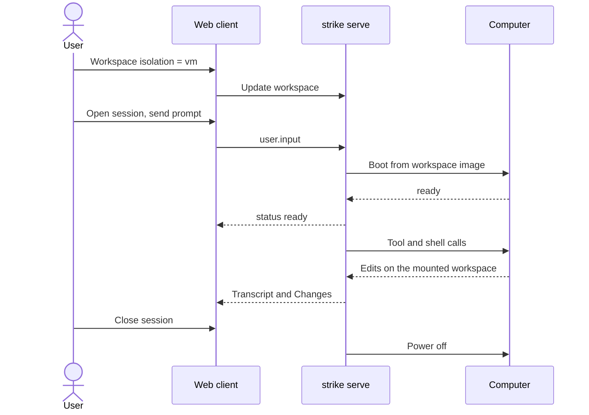
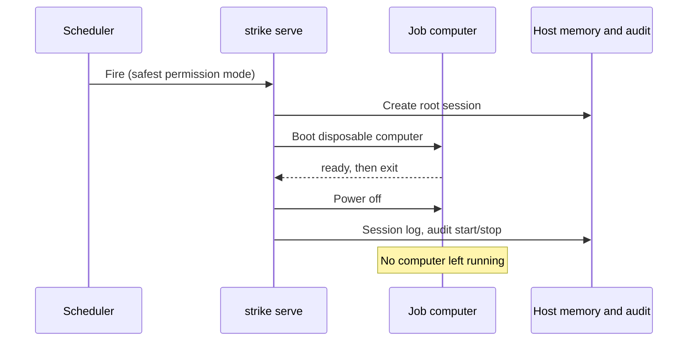
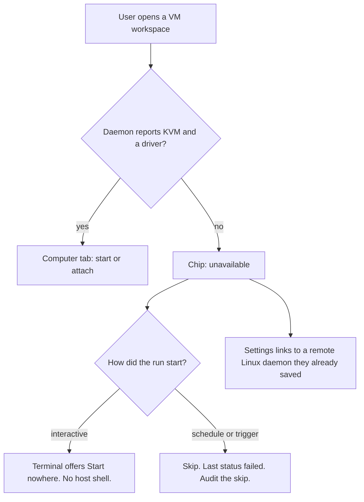

# Sandbox product: what the computer feels like

Status: design note for [#1290](https://github.com/jonathanung/strike/issues/1290)
(product angle). Parent: web UI epic
[#1273](https://github.com/jonathanung/strike/issues/1273).
Docs only. This file does not change `webui/` or the daemon.

Companion angles (architecture, runtime, security, self-config) own mechanism.
This note owns what a person sees, the defaults they live with, and the
order in which that surface should appear.

## Verdict

**Go with conditions.**

1. The user-facing object is a **computer for a workspace run**, drawn only
   when a daemon route reports one. The cockpit does not grow a hypervisor
   console, and it does not draw an empty Computer tab
   ([webui-planned.md](../../webui-planned.md)).
2. The definition is **per workspace**. The instance is **per run** (an
   interactive session, a scheduled fire, a trigger, a goal, or a task-runner
   board). Children share that computer and keep using git worktrees.
3. **Local stays the default.** A workspace opts into a computer. Unattended
   work on a VM workspace never silently runs on the host. Interactive and
   job computers stay separate, and the idle daemon holds none.
4. **Strike stays on the host.** The daemon, transcript, memory, audit,
   scheduler, and web client stay where `strike serve` already runs. The
   guest runs the workspace's tools and shells. Secrets stay on the host
   (credential proxy). The existing OS sandbox dial keeps its name and its
   route.
5. **Phase 0 can kill this.** If the machines that run `strike serve` have
   no KVM, or the maintainer cannot name a workflow that worktrees plus the
   OS sandbox plus the container runtime fail to cover, stop. Do not build
   the panel.

Effort: Phase 0 **S**, MVP **L**, beta **XL**. Sizes are integration size,
not a calendar.

## Evidence

Read for this note:

| Source | What a person actually sees |
|---|---|
| [#1290](https://github.com/jonathanung/strike/issues/1290) | RFC. Five angles. `session.childIsolation` suggested as none/worktree/vm. Goal: agents in a NixOS dev environment that can configure itself, harness considered for inside the guest. |
| [peasant-labs/infra](https://github.com/peasant-labs/infra) | CI jobs. Callers see a router reason (`pool-online`, `pool-busy`, `pool-stale`, `query-failed`) and otherwise a normal job log. [runner-vm-spike-report.md](https://github.com/peasant-labs/infra/blob/main/docs/runner-vm-spike-report.md) (2026-09-30): one Cloud Hypervisor VM per job, slot powers off after the job, idle pool holds no memory, guest journal forwarded to the console because failures were invisible, boots serialized inside one planning cycle. Their measured queue-to-runner on that desktop was about 35s (about 10s to userspace, then about 15s loading a baked image). Those clocks are their measurement, not a Strike target. |
| [runner-dispatcher/README.md](https://github.com/peasant-labs/infra/blob/main/runner-dispatcher/README.md) | Go driver: long-poll a GitHub scale set, mint JIT config, `driver.Boot`. Drivers named there: `dryrun`, `systemd` slot units, `subprocess`. The intro still says the hypervisor driver is unwired and boot smoke is unchecked; the spike report says real jobs booted. Treat the spike as lifecycle evidence. Do not take the GitHub queue as something Strike should adopt. |
| [nix-openclaw-vm](https://github.com/dayvidpham/nix-openclaw-vm) | NixOS modules, not a UI. Guest runs an OpenClaw gateway (default port 18789) and OpenCode (default port 4096, attach with `opencode attach`). Module defaults in `guest.nix`: 2 vCPU, 8192 MiB, virtiofs for `/nix/store` off, `dangerousDevMode` autologin for development only. Credential proxy is host-side (VSOCK, OIDC/OpenBao); the guest gets `HTTP_PROXY` and a CA. A debug Tailscale module is development-only. |
| Strike `webui/` and [webui-daemon.md](../../webui-daemon.md) | Rust shell after #1258: session list, transcript, composer, side panel (Activity, Files, Changes), Daemon view for workspaces and remotes. Schedule, memory, task runner, terminal, editor, and git panels are specified and not drawn. |
| [webui-planned.md](../../webui-planned.md) | Workspace binding is not on the live session yet. `session.childIsolation` `worktree` is the only extra child isolation, default shared. |
| [isolation.md](../../isolation.md), [web-cockpit-contract.md](../../web-cockpit-contract.md) | `sandbox` already means the OS process dial (`off` / `read-only` / `workspace-write`), surface id `sandbox`, `GET/PATCH /v1/sandbox`, tier C. Worktrees and the container runtime ([container.md](../../container.md), epic #547) are further layers. |
| [plugins.md](../../plugins.md), [plugin-panes.md](../../plugin-panes.md) | A plugin is a package of skills, MCP, and declarative panes. It is not a new runtime. Panes do not own a raw PTY. |
| Cursor cloud agents ([docs](https://cursor.com/docs/cloud-agent), [background agents](https://cursor.com/help/ai-features/background-agents), [capabilities](https://cursor.com/docs/cloud-agent/capabilities)) | One isolated cloud VM per agent, environment defined per repo (snapshot, Dockerfile, or agent-led setup), parallel runs, laptop can close, PR plus screenshots/video/logs, optional remote desktop and computer use. Cursor hosts the machine. |
| Kiro ([product](https://kiro.dev/), [Crew task runner](https://kiro.dev/docs/crew/features/task-runner/), [Web sandbox](https://kiro.dev/docs/web/sandbox/)) | IDE/CLI for local work. Crew is a persistent workspace whose task runner decomposes a markdown spec, runs steps, retries, and checkpoints for long unattended work. Kiro Web runs each task in its own cloud sandbox, keeps that sandbox's files with the session, deletes the sandbox with the session, and configures internet, secrets, and environment under Settings → Sandbox. Sandboxes include a headless browser. Page dates checked: sandbox docs 2026-10-21. |
| Grok Bot ([overview](https://docs.x.ai/grok-bot/overview), [computer](https://docs.x.ai/grok-bot/computer-and-apps), [approvals](https://docs.x.ai/grok-bot/approvals-security-and-privacy)) | Conversation-first. Named bots share **one** persistent cloud computer per account (files, browser cookies, CLI credentials). Each bot has its own screen; the docs say the screen is a work surface, not a security boundary. A preview sits in the conversation's side panel. The local Mac/Windows machine is a separate approval setting, default "ask every time". Docs checked 2026-10-22. |

This host, while the note was written: `/dev/kvm` exists, `uname` is
`Linux 6.12.94+ x86_64`, `nix` is not installed, `cloud-hypervisor` is not
installed. No guest was booted. No UI was screenshotted. Product behavior
below is a specification, not a report of a running Strike computer.

## What the user feels

Three nouns, and no fourth app.

| Noun | Who owns it | Lifetime |
|---|---|---|
| **Workspace** | Already the registry in the Daemon view (#1260): a directory, a rules file, a permission mode. Gains an environment: image or flake id, resource cap, egress policy name, optional pinned snapshot. | Until the user removes the workspace. |
| **Run** | A root session, a schedule fire (#1276), a trigger delivery (#1282), a goal (#1284), or a task-runner board (#1277). | The existing object. A run may own one computer. |
| **Computer** | The microVM for that run. States: `absent`, `queued`, `booting`, `ready`, `stopping`, `failed`. | Interactive: from start until the user stops it or the session ends. Job: boot, run, power off. |

The git checkout lives on the daemon host, in the workspace directory.
The computer mounts that directory. Guest home, the Nix store, and the
package profile live on the computer's disk. Files and Changes keep
talking about the workspace directory. The editor never grows a sync
progress bar in the MVP.

```text
host (strike serve, always on)
  transcript, memory, audit, schedules, web client
  workspace directory  ----mount---->  computer (off until a run needs it)
                                         shell, tools, Nix profile, guest home
```

### Where it appears in the current shell

The Rust client is a session list, a transcript, a composer, and a side
panel. The computer attaches there.

| Place | When `isolation` is `local` | When the workspace has opted into a computer |
|---|---|---|
| Daemon view, workspace row | No chip. | Chip `computer` or `unavailable` (no KVM on that daemon, or the driver is missing). The opt-in lives here, next to the workspace's permission mode. |
| Session row | Unchanged. | Status from the shared status component (#1263): `booting`, `ready`, `queued`, `failed`. |
| Transcript | Unchanged. | One line when the state changes ("Computer ready", "Computer failed: …"). The boot journal stays in the panel. |
| Side panel | Activity, Files, Changes. | A **Computer** tab with state, configured vCPU and memory, Start, Stop, the boot log tail, and links to Terminal, Files, and Changes. Snapshot and Restore appear in beta, not as disabled buttons before that. |
| Terminal (#1279) | PTY in the workspace directory on the host, under the permission mode. | PTY in the guest, same directory path, same permission mode. A visible label: the shell is on this computer. If the computer is off, the tab offers Start. It does not open a host shell. |
| Files (#1269) and Changes (#1270) | Daemon routes for the workspace directory. | The same routes. The mount makes guest edits show up as ordinary file and git changes. |
| Settings (#1280) | Theme, density, links to model and approval. | A **Computers** section that links to the workspace control and shows daemon facts: KVM present or not, driver present or not, the cap, where this daemon runs (this machine or a saved remote). Isolation is daemon config. Theme stays browser storage. The page says which is which. |
| Chat layout (#1285), later | Cockpit remains the default. | The same computer as a slide-over. The conversation shows a compact card with the state. Phone width: state, Start/Stop, log tail. Terminal and the editor stay a desktop drawer. |
| Usage and audit (#1286) | Tokens, and cost only when the price is known. | Audit rows for start, stop, snapshot, restore, isolation change, and an approved rebuild. Usage shows duration and the configured size. No dollar amount for the VM. |

Composer chips (model #1259, approval #1266) stay as they are. Approval
mode still decides when a tool asks. The computer decides where the tool
runs. `yolo` does not turn the computer off, and a computer does not skip
asks. That is the same two-dial rule as
[isolation.md](../../isolation.md), with a third layer beside it.

### Name

The UI word is **Computer**. Config and protocol say `isolation: local|vm`
on the workspace, and the existing child values stay `shared|worktree`.

The word **sandbox** stays on the OS dial (`/sandbox`, `/v1/sandbox`, Ops
surface `sandbox`). Reusing it for the VM would make the shipped explain
page describe the wrong machine.

`session.childIsolation: vm` is the wrong user-facing switch. A child does
not get its own computer in this plan. It inherits the run's computer and,
when asked, a worktree on the mount (#1270).

### Settings and defaults

| Knob | Recommended default | Why |
|---|---|---|
| Workspace isolation | `local` | Matches today: shared directory, OS sandbox, opt-in worktree. A computer is an opt-in on that workspace. |
| New session on a VM workspace | Attach the run's computer. Boot it if the state is `absent`. | The user already opted in on the workspace. A second confirm on every session teaches people to ignore confirms. |
| End of an interactive session | Stop the computer. | No idle timer in the MVP, so there is no invented timeout. |
| End of a job run | Power off and keep the session log. | Same lifecycle Peasant measured: the slot does not stay resident. |
| Job arrives while the interactive computer is up | Job waits (`queued`). | MVP cap is one computer on the daemon. The job must not share the interactive shell. |
| Heartbeat schedule (#1276) | Runs on the host. Does not boot a computer. | A quiet check that boots a VM is no longer quiet. |
| Unattended run, isolation `local` | Host, in the safest permission mode that schedule and trigger issues already require. | Do not auto-upgrade someone to a VM. |
| Unattended run, isolation `vm`, KVM or driver missing | Skip the run. Record `failed` with the reason. Do not run on the host. | The opt-in is a promise. |
| Interactive, KVM or driver missing | Chip `unavailable`. Terminal offers no host fallback. | Same promise. |
| Resources | 2 vCPU and 2048 MiB until Phase 0 writes down what the maintainer's machine actually spared. | OpenClaw's module default is 2 vCPU and 8192 MiB. Peasant's CI slots were 6 vCPU and 4 GiB. Both are their choices. 2048 MiB is a starting cap to revise, not a measurement. |
| Concurrency | One computer at a time. Further starts show `queued`. | Peasant's idle goal was no constant reservation. A cap of one keeps the first host honest. |
| Keep-warm | Off. | Idle means no VM. |
| Snapshot | None until beta. Then manual, with one pinned snapshot that job runs boot from. | Automatic snapshots would become a second memory store. |
| Restore | Confirm. Default scope is guest home and the Nix profile. Git state stays where the workspace directory has it. | Restoring a disk must not rewind the user's branch. |
| Egress | Whatever the security angle sets. The panel shows the policy name. | This note does not invent an allowlist UI. |
| Secrets | "Credentials: proxied." The value is not in the panel, the log tail, or the editor. | OpenClaw's proxy is the model. |
| Env rebuild (self-config angle) | The agent may edit the flake. Applying it is an approval (#1266) showing the diff. Failure rolls back to the previous boot. | The user reviews the environment the way they review a shell. |
| macOS or Windows daemon | `unavailable`. Offer a remote Linux daemon the user already owns ([webui-daemon.md](../../webui-daemon.md) remotes). | The computer runs where the daemon runs. Lima is not a second product in the MVP. |
| OS sandbox dial inside a computer | Leave the shipped default (`workspace-write`) in the guest. | The VM is the host boundary. The dial still matters for paths inside the guest. |
| Harness process | Tools and shells in the guest. `strike serve` on the host. | The web client has to work while the computer is off, or the claw is the VM and the daemon is not actually always on. |

## Mock flows

### 1. Opt in, then a normal turn

The workspace picker (#1260) is in the Daemon view. The user opens a
workspace that already has a directory and a permission mode.

1. They set isolation to `vm`. The row shows `unavailable` or `booting`
   only after a route says so. Before the driver exists, the control is
   absent, not a dead switch.
2. They open a session in that workspace. The session row shows `booting`.
   The transcript has one line.
3. The Computer tab reaches `ready`. Configured size is on the tab. A live
   CPU graph appears only if the driver reports a real counter.
4. They send a prompt. The agent's shell is inside the guest. A file edit
   shows in Changes, because the workspace directory is the mount.
5. They open Terminal. The label says the shell is on this computer. A
   second terminal is another PTY in the same guest (#1279), with a clear
   mark when the agent and the user share one.
6. They leave the session. The computer stops. The session log remains.
   Memory keys (#1271) remain, because they were written on the host.



### 2. Scheduled run (claw)

The daemon is up (systemd user unit). No computer is up. A schedule fires.

1. The schedule starts a root session, safest permission mode, as #1276
   already requires.
2. The workspace isolation is `vm`, so the run boots a **new** computer
   from the pinned snapshot (beta) or the workspace image (MVP). It does
   not attach to yesterday's interactive shell.
3. The Schedule row shows last status and a link to that session. The
   session's Computer tab is the same component, state `booting` then
   `ready`.
4. The run finishes or fails. The computer powers off. The session stays
   in the list. An audit row records start and stop (#1286).
5. If a run is already using the one slot, this fire stays `queued` on the
   schedule's overlap policy. It does not share the slot.

A trigger (#1282) uses the same path. A heartbeat does not.



### 3. Goal and task runner

A goal (#1284) holds **one** computer for the goal run. Pause, abort, or
a verification failure that the goal is specified to stop on also stops
the computer. Stall detection applies to "still booting" as well as to a
quiet model: a boot that never reaches `ready` is a blocked goal, not an
endless spinner.

A task-runner board (#1277) shares that one computer across sections.
Checkpoints stay the plan section plus the child verification report.
They are not VM snapshots. A child that asked for a worktree gets one on
the mount (#1270). The Worktree view lists the worktree and the child.
It gains a computer column only in beta, when more than one computer can
see the repo.

### 4. Chat layout, later

#1285 is a presentation mode over the same session. The card in the
conversation and the slide-over are the Computer tab, collapsed. Closing
the laptop does not stop a job that has already booted, because the
daemon is the thing that stays up. Closing the laptop does not keep a
computer warm by itself.

Phone (#1289 gateway): watch state, start, stop, read the log tail.
Approving a rebuild uses the same approval card as a shell ask.

### 5. This daemon cannot boot



## How it composes with the open streams

| Issue | Relationship |
|---|---|
| #1259 model menu | None. Model selection stays a host concern. The guest does not gain a model picker. |
| #1260 workspaces | Binding lands first. A computer rooted at the daemon's cwd would repeat the gap the planned doc already names. |
| #1269 editor | Read-only by default, explicit save, hash/mtime conflict. Paths are the workspace mount. Guest home is not in the tree. |
| #1270 git and worktrees | Worktrees stay the child file isolation, on the mount, so they survive power-off. No force-push, confirm destructive restore. |
| #1276 scheduler | The clock stays in the daemon. A fire may boot a disposable computer. Overlap uses `queued` while the single slot is taken. |
| #1277 task runner | Sections share the run computer. The board does not become a VM list. |
| #1279 terminal | The PTY implementation is that issue's. This note only chooses which machine it attaches to, and forbids a silent host fallback. |
| #1280 settings | Link out. Do not rebuild workspace controls inside Settings. |
| #1284 goals | One computer per goal run; stop with the goal; boot failure is a stall. |
| #1285 chat | Same session, slide-over card. Cockpit stays the default. |
| #1286 usage and audit | Duration and configured size. Audit the sensitive computer actions. Never invent a price. |
| #1266 approvals | Rebuild, restore, and "run this skipped job on the host anyway" are asks. A click on Start is the user's own action. |
| #1271 memory | Host store. A disposable computer that held the only copy of memory would forget on power-off. |

Container epic #547 stays the Docker/Podman path
([container.md](../../container.md)). The Computer control does not also
launch those containers. Three backends in one picker (OS sandbox, container,
microVM) is how the first-run card becomes a platform diagram.

## Claw-style always-on, and a chat product later

The always-on piece is the per-user daemon
([webui-daemon.md](../../webui-daemon.md)): schedules, triggers, memory,
audit. Peasant's pool is the right picture for the computer itself. Slots
exist as units and consume no RAM until a job is assigned; each job gets
a fresh guest; caches can be shared; credentials for the control plane stay
on the host.

OpenClaw is the other picture: a long-lived guest with a gateway and an
editor inside it. That fits an appliance. It fits Strike's web client
poorly, because the client has to open while the guest is off, and memory
(#1271) has to outlive the guest.

A later conversation-first product (#1285, and the direction on #1276
through #1286: between Grok Bot and a dev harness) keeps this split:

- The conversation is the front door. The computer is a card, then a
  slide-over, then the full tab for people who want files and git.
- Named agents and durable memory stay host objects (#1271), so they
  survive a power-off.
- Demonstrated skills and scheduled reruns are host schedules that happen
  to boot a computer when the workspace asked for one.
- Shared browser cookies across every agent on an account are out of
  scope. Grok documents that sharing as a property of one computer per
  account. Strike's runs are the isolation boundary the audit log talks
  about.

## Comparison

| | Cursor cloud / background agents | Kiro Web sandbox and Crew | Grok Bot computer | Strike computer (this note) |
|---|---|---|---|---|
| Who hosts the machine | Cursor | Kiro, for Web | xAI, one computer per account | The user's daemon host. Remotes are other daemons they own. |
| Grain | One VM per agent run | One sandbox per Web task; Crew is a local long-running workspace | One computer, many bots, separate screens | One definition per workspace, one VM per run |
| What survives | Environment snapshot, branch, PR, artifacts | Sandbox files live with the session and die with it; steering syncs | Memory, files, cookies, logins | Host session, memory, audit. Guest disk dies unless the user pinned a snapshot. |
| How you watch | Transcript, PR artifacts, optional remote desktop | Task runner checkpoints; Web session | Side-panel computer preview in the chat | Status chip, one transcript line, Computer tab |
| Shell and files | In the VM; user can take the desktop | In the sandbox; settings for env and secrets | On the shared computer; local machine is a separate ask | Terminal and editor already planned, attached to the mount |
| Always-on | Schedules and automations in Cursor's cloud | Crew task runner for long unattended work; Web automations | Bots keep working with the laptop closed | Daemon stays up. Computers boot per run. |
| Desktop computer-use | In product (mouse, browser, screenshots) | Headless browser in the Web sandbox | The product | Out of scope through beta |
| Strike should copy | Environment as an inspectable, pinned snapshot; artifacts stay on the run; parallel only after the cap is real | File state follows the run; deleting the run's computer is explicit; sandbox settings are a small page | Conversation card plus a side panel; local machine is a separate consent | — |

What Strike should leave alone: a hosted multi-tenant fleet, a shared
account computer, and an embedded IDE inside the guest (OpenCode on port
4096 is an upstream operator surface, not the Strike editor).

## Build, adopt, or partner

| Part | Decision | User-visible consequence |
|---|---|---|
| Cockpit Computer tab, chips, chat card | **Build** | Nothing in Peasant or OpenClaw is this shell. Own module under `webui/src/`, CSS in a `feature:computer` block, when implementation starts. |
| Workspace opt-in and session binding | **Build** on #1260 | The chip is a field on the workspace they already edit. |
| Boot, power-off, one slot, idle holds nothing | **Adopt** the Peasant slot lifecycle (`systemd` units or a supervised boot command). Leave the GitHub scale-set adapter. | Users see `queued` / `booting` / `ready` / off. They never see a scale set. |
| NixOS guest image and microvm.nix | **Partner** on the image recipe (Peasant runner image, OpenClaw guest modules). Strike owns a thin module: workspace mount, no host credential files, journal on the console. | "Image" on the workspace row is a named, signed build. Phase 0 confirms the license before any vendoring. |
| Credential proxy | **Adopt** the OpenClaw shape (host proxy, guest sees a proxy env and a CA). Partner on the code if the license allows; otherwise reimplement the shape in Strike. | A status line, not an OpenBao admin UI. |
| Terminal | **Build** on #1279, attach the PTY to the guest | Same tab, different machine, labeled. |
| Editor and file tree | **Reuse** #1269 | Shared mount. No Mutagen-style sync product. |
| Git and worktrees | **Reuse** #1270 | Worktrees on the mount. |
| Scheduler and triggers | **Build** a hook on the "start a root session" path #1276 and #1282 already share | Schedule history links at the session. No second queue. |
| Snapshots | **Adopt** the hypervisor's snapshot if the runtime angle proves one. **Build** the confirm dialog and the pin. | Beta. Two scopes: guest disk, or guest disk plus a warning that git is included. |
| OS sandbox, permissions, audit | **Reuse** | Existing dials and #1286. |
| Agent Plugins package / pane that boots VMs | **Do not** | [plugins.md](../../plugins.md) forbids a plugin from being a new runtime. A pane must not own the PTY ([plugin-panes.md](../../plugin-panes.md)). |
| Hosted Strike cloud, remote desktop, mouse computer-use | **Do not** through beta | That is Cursor and Grok's product. A remote here is a daemon the user runs. |
| Docker/Podman path (#547) | **Leave on its epic** | Separate control. |

## Phased plan

### Phase 0 — spike (S)

Product work is this note plus a maintainer trial on a machine that
actually runs `strike serve`. No `webui/` change. A throwaway boot script
is in scope for the runtime angle; this angle only needs the answers below.

Exit:

- Jonathan accepts or edits the defaults table, in writing, on the issue.
- The trial host either boots one guest to a shell and powers it off, or
  records that it cannot (no KVM, no Nix, driver missing). This cloud VM
  had `/dev/kvm` and did not have Nix or Cloud Hypervisor; it does not
  count as the trial.
- The trial records the same phases Peasant named (queued, slot started,
  userspace, ready, powered off) with that host's own clocks. Those clocks
  are evidence, not an acceptance target copied from Peasant.
- A named workflow is written down that `local` plus worktree plus OS
  sandbox does not cover. If nobody can name one, verdict flips to
  **no-go** and the later phases do not start.
- License of any code we would vendor is recorded.

### MVP (L)

One Linux daemon with KVM. One workspace opt-in. One computer at a time.
Start, stop, state, boot log, guest terminal, files and diffs through the
existing routes, a scheduled run that boots a different computer and
powers it off, audit rows for start and stop, `unavailable` with no host
fallback.

Blocked until #1260 actually roots the session in the workspace directory,
and until #1279 has a real PTY to attach. Shipping the tab earlier would
draw an empty panel.

Exit:

- On the trial host, a person can opt in, watch `booting` then `ready`,
  get a guest shell from Terminal, save a file through the editor, see it
  in Changes, stop, and observe that the guest process is gone.
- A schedule fire while no interactive computer is up creates a session,
  boots, powers off, and leaves the session link. Memory written on the
  host is still there.
- A schedule fire on a VM workspace with KVM missing is a skipped run with
  a reason, and the workspace directory has no new agent edits from that
  fire.
- With isolation `vm` and the computer stopped, Terminal does not present
  a host shell. A browser check covers that.
- The OS sandbox page still describes bwrap / sandbox-exec only.
- `make test`, `make vet`, the wasm build, and `webui-smoke` are the
  implementation gate (tier C once permissions, audit, and the session
  boundary are touched). They are not this PR's gate.

The L is the integration (workspace binding, PTY, driver, one panel), not
the visual design. The panel itself is a small module.

### Beta (XL)

Snapshots and the restore confirm, a pinned image for job boots, chat
slide-over and phone log tail, a goal that holds one computer and releases
it on pause/abort, two workspaces with two flakes, orphan reclaim after a
daemon restart, audit coverage for restore and rebuild, a computer column
on the worktree list if two computers can mount one repo.

Exit:

- Restore of "guest home and Nix profile" leaves git HEAD where it was.
  Restore that includes git requires the destructive confirm #1270's plan
  already uses.
- A daemon restart mid-run either reattaches the slot or reclaims it, and
  a second start does not stack a duplicate guest. Peasant's spike left
  live restart and mid-job drain unexercised; beta does not ship while
  that is still true for Strike.
- Chat mode and the cockpit show the same state for the same session.
- A goal that fails its verification and is specified to stop does not
  leave a computer running.
- macOS is documented as remote-daemon-only, with the `unavailable` chip
  verified against a daemon that reports no KVM.

## Metrics

Instruments to add when the feature exists. No targets in this note.
Peasant's 35s is their result; cite it beside Strike's phases, do not
adopt it as the bar.

| Instrument | Proves |
|---|---|
| Phase timestamps on the run: requested, slot started, userspace, ready, powered off | The chip and the log describe the same boot. A `ready` that arrives before a guest shell accepts a command is a broken instrument. |
| Count of guest processes left after a terminal run status, and after daemon restart | Disposable means disposable. Beta's orphan count has to be zero on the trial host before the snapshot UI is trustworthy. |
| Count of VM-workspace runs that executed a tool on the host | Has to stay zero. This is the fallback-honesty metric. |
| Count of workspaces on `vm` versus `local`, and of runs that booted | Whether anyone turns it on. A large build with this at zero is a no-go signal, read after people have had a chance to opt in. |
| Computer-tab actions per run (start, stop, snapshot, restore, rebuild approval) beside "opened the transcript only" | Whether the tab is pulling people out of the conversation. A chat card that nobody can finish a run from is incomplete. A tab nobody opens can stay a chip. |
| Redaction findings in the boot log and the terminal scrollback (`pkg/redact`, [secrets.md](../../secrets.md)) | Credential proxy health, as something the user can trust. The desired reading is an empty finding list for material the proxy was supposed to keep on the host. |
| Memory key present after the job computer is gone | The claw store is the host store. |
| Worktrees remaining after power-off, and stale ones #1270 already knows how to list | The mount did not take the worktree with the disk. |
| Skip reasons when KVM or the driver is missing | `unavailable` is a real state, not a blank chip. |

A Phase 0 no-go does not need these series. It needs the named-workflow
line and a boot-or-cannot record.

## Risks

| Risk | What the user would feel | Response |
|---|---|---|
| Boot is long enough to feel broken inside a single turn | The composer spins with no shell | Boot per run, never per message. Transcript line plus log tail during `booting`. |
| Serialized boots (Peasant saw this inside one planning cycle) | Task-runner sections look stuck | MVP shares one computer. `queued` is a status, not a hang. |
| Two meanings of sandbox | `/sandbox` and the Computer tab contradict each other | Different names, different routes. |
| Computer rooted at the daemon cwd | Files appear in the wrong project | Blocked on #1260. |
| Shared mount is too weak, or a full clone is too strong | Either the guest can touch host paths it should not, or the editor and the agent diverge | Security angle can forbid the mount. The product fallback is a visible "bring changes back" action and a banner that Files are the computer's copy. Default until then: shared mount of the workspace directory only. |
| Self-config rebuild bricks the guest | `ready` flips to `failed` mid-conversation | Approval before apply, rollback to the previous boot, log tail open. |
| Grok-style shared computer | A scheduled job types into the user's open terminal | Job computers are new instances. MVP refuses a second concurrent boot by queueing. |
| Scope grows into desktop computer-use and a hosted fleet | The cockpit becomes a remote desktop product | Out of scope through beta. |
| Plugin packaging | Users expect `strike plugin install` to gain a hypervisor, and a pane starts a PTY | Daemon subsystem plus a NixOS module. Not an Agent Plugin. |
| Doc drift upstream | We adopt a README that disagrees with the spike | Adopt the measured lifecycle. Re-read both Peasant files when implementation starts. |
| Phone starts a computer the phone cannot drive | A VM is left running with no terminal | Phone can stop, and session end stops an interactive computer. |
| This cloud image has KVM and still cannot build Nix | A green demo here would be theater | The trial is the maintainer's `strike serve` host. |

## Open questions

Each recommendation is the default if Jonathan does not pick another.

| # | Question | Recommended default |
|---|---|---|
| 1 | UI noun, given `sandbox` is taken? | **Computer.** Config value `vm` on workspace isolation. |
| 2 | VM per workspace, per session, or per child? | **Definition per workspace, instance per run.** Children share it and use worktrees. |
| 3 | Does "run the harness in the VM" mean `strike serve` moves into the guest? | **No.** Tools and shells move. The daemon stays. |
| 4 | Should OpenCode, or any in-guest IDE, be the user's editor? | **No.** #1269 is the editor. An in-guest agent process is a runtime detail with no Strike chrome. |
| 5 | Default isolation for a new workspace? | **`local`.** |
| 6 | Unattended run on a `local` workspace? | **Host, safest permission mode.** Do not auto-upgrade to `vm`. |
| 7 | Unattended run on a `vm` workspace when the daemon cannot boot? | **Skip and record the reason.** |
| 8 | Interactive fallback to a host shell? | **No.** |
| 9 | Idle timeout? | **No timer in the MVP.** Session end stops an interactive computer. Job end powers off a job computer. |
| 10 | Resource cap before the trial? | **2 vCPU, 2048 MiB, one computer.** Replace with the trial host's notes. |
| 11 | Automatic snapshots? | **No.** Beta: manual, plus one pin for job boots. |
| 12 | Where do scheduled runs and chat mode put the chrome? | **Same Computer surface,** as a schedule link, a transcript line, and later a chat slide-over. |
| 13 | Ship as an Agent Plugin? | **No.** Daemon service and a NixOS module. |
| 14 | Desktop computer-use and a Cursor-like hosted fleet? | **Out of scope through beta.** |
| 15 | Shared mount or copy-in/copy-out? | **Mount the workspace directory.** Switch to an explicit "bring changes back" flow only if the security angle forbids the mount. |

## Related

- [#1290](https://github.com/jonathanung/strike/issues/1290) — RFC
- [#1273](https://github.com/jonathanung/strike/issues/1273) — web UI epic
- [webui-planned.md](../../webui-planned.md) — panels that must not be drawn empty
- [webui-daemon.md](../../webui-daemon.md) — current shell and remotes
- [isolation.md](../../isolation.md) — OS sandbox, worktrees, containers
- [container.md](../../container.md) — Docker/Podman path, left on its epic
- [plugins.md](../../plugins.md) — why this is not a plugin
